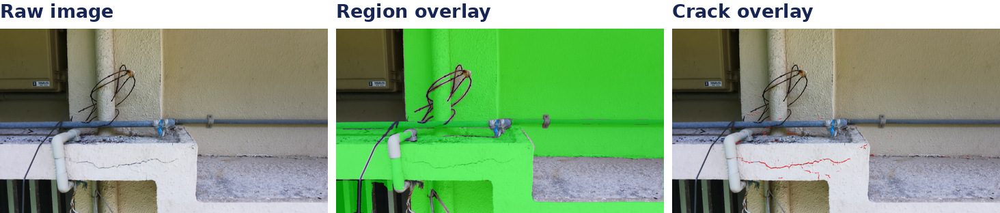
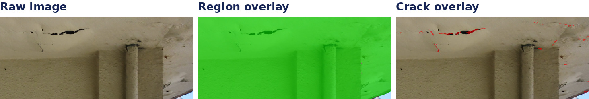

# Painted-wall crack detection

The pipeline identifies an eligible painted-wall region, uses a DINOv3 detail decoder to score cracks in the original RGB image at native resolution, then filters detections near fixtures and surface edges. The region is selected using surface recognition and depth without filtering by a dominant wall color. Brick, masonry, and metal siding are included in the surface prompts. Inference uses the bundled 200-epoch checkpoint at `weights/detail-200ep.pt` by default.

## Set up a clean clone

Use Python 3.12 and [uv](https://docs.astral.sh/uv/). Clone this repository and run the remaining commands from its root.

```bash
git clone https://github.com/Leofuku00/crack_detection.git
cd crack_detection
uv sync --locked
cp model.env.example model.env
```

Download the DINOv3 **ViT-B/16 LVD-1689M** checkpoint from [Meta's DINOv3 downloads](https://ai.meta.com/resources/models-and-libraries/dinov3-downloads/). To generate the building mask automatically, also download the **ViT-L/16 LVD-1689M** checkpoint, **dino.txt ViT-L/16** head and text encoder, and [tokenizer vocabulary](https://dl.fbaipublicfiles.com/dinov3/thirdparty/bpe_simple_vocab_16e6.txt.gz). Save the files in `weights/` under the filenames listed in `model.env`. The first run downloads the pinned DINOv3 source and the Hugging Face models it needs into the repository’s `.cache/` directory. The published decoder checkpoints are already in `weights/`.

## Run inference

Use the bundled sample to try automatic region selection. For another photo, place it under `data/` and pass its project-relative path.

```bash
uv run --env-file model.env python scripts/predict_inspection_cracks.py \
  --image data/reproduction/images/動画像3-058.png \
  --output results/example
```

Pass `--region-mask data/reproduction/region_masks/動画像3-058.png` to use a same-size, single-channel binary building mask. This skips automatic region generation and requires only the ViT-B/16 checkpoint from Meta. The output directories contain full-resolution masks and overlays for the eligible region (green) and final crack predictions (red).

## 200-epoch results

The detail head was fine-tuned for 200 epochs from `weights/detail.pt` on 721 CCSS images and three hard-negative images. The DINOv3 backbone and coarse decoder stayed frozen. The table reports mean pixel-level metrics on the same three held-out wall images, using their saved building masks and the same inference settings.

| Checkpoint | Dice | IoU |
| --- | ---: | ---: |
| Starting checkpoint | 0.1815 | 0.1019 |
| 200-epoch checkpoint | **0.1831** | **0.1029** |

The overlays show the eligible inspection region in green and predicted crack pixels in red. Some red marks follow surface edges or fixtures.

**Held-out wall 3-058**



**Held-out wall 1-028, ceiling detail**



## Reproduce the 200-epoch run

The repository includes the starting decoder, three held-out wall images with labels and building masks, and the three hard-negative pairs used in training. The evaluation image order and paths are recorded in `configs/dinov3_detail_decoder.yaml`.

Evaluate the published checkpoint on the bundled holdout after following the setup above. The saved building masks mean this benchmark only needs the ViT-B/16 checkpoint from Meta.

```bash
uv run --locked pytest
uv run --env-file model.env python scripts/run_experiment.py
```

To repeat the 200-epoch fine-tuning, download the [CCSS training dataset on Kaggle](https://www.kaggle.com/datasets/parniashokri/ccssdata) and extract it so these paths exist inside the clone:

```text
data/ccss/CCSS-DATA-V4-withVal/benchmarkingDatasets/train/noAugmentation-noPatch/img/
data/ccss/CCSS-DATA-V4-withVal/benchmarkingDatasets/train/noAugmentation-noPatch/lbl/
```

```bash
uv run --env-file model.env python scripts/run_experiment.py --train
```

This starts from the bundled `weights/detail.pt` and trains the detail head for 200 epochs. The runner writes the new checkpoint and overlays under `results/visualizations/` and saves the effective configuration and metrics under `results/runs/`. Hardware and library differences can affect the exact results.
